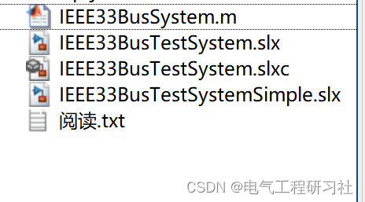

# Simulation Research of IEEE33 Nodes in Power System with Simulink (Matlab Realization)

​
1. Overview of the characteristics of the integrated model
[1]The values of bus load and branch impedance are obtained from the MATPOWER (version 7.0) case data.
[2] Each branch is equipped with a circuit breaker for reconfiguration of the system.
[3] The model receives the input of the circuit breaker status and outputs the voltage and current measurement values for each branch - Model simulation can be conducted in two ways to enhance its usability - > Method 1: Run it in Simulink by manually setting the circuit breaker status (recommended for simpler "single run" studies) - > Method 2: Run it by adding an additional MATLAB script (provides more comprehensive control and data processing, allowing for simulation automation).
Detailed article download link: Optimal sizing of capacitors placed on a radial distribution system -  Academic (baidu.com)
2 Simulation Model Download Link:
Editor
​

## Images

<!-- PAYMENT_BLOCK -->

## Get this dataset

- Payment link (Stripe): [Buy now](https://buy.stripe.com/3cs8yP7sY87d0vu9AB)
- Payment QR code: 

<!-- /PAYMENT_BLOCK -->
